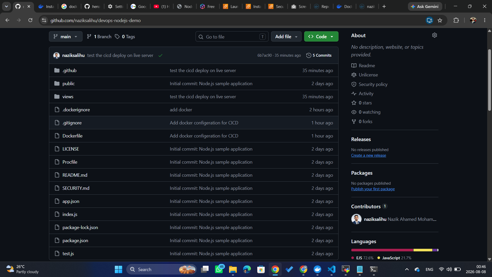
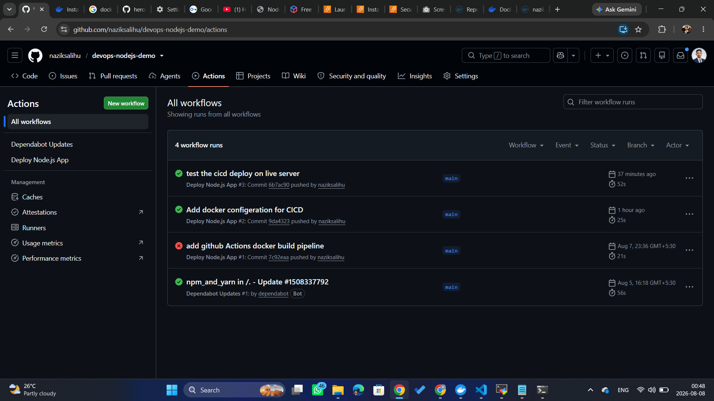
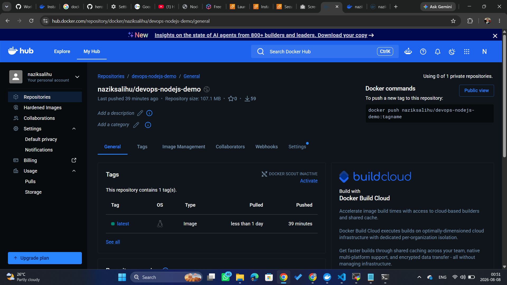
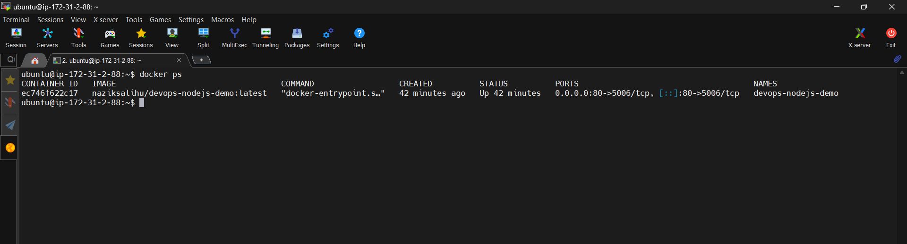
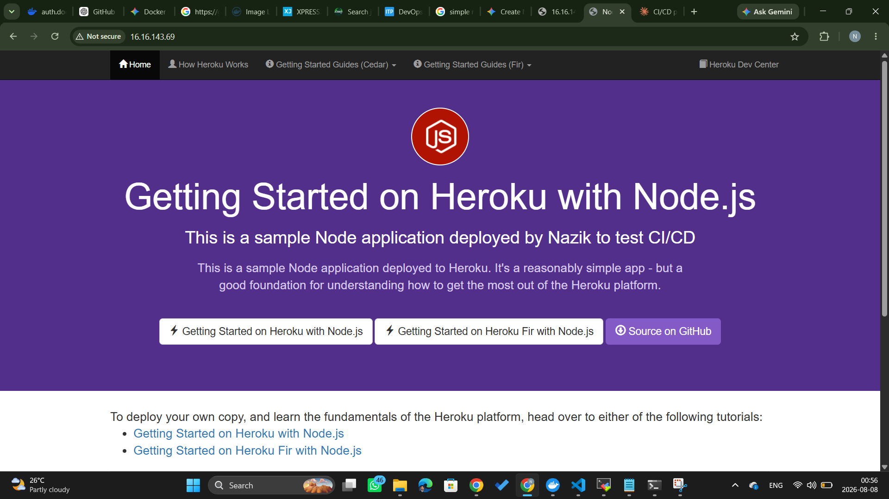

# Node.js CI/CD Deployment with Docker and AWS EC2

## Project Overview

This project demonstrates an end-to-end CI/CD pipeline for deploying a Node.js application using modern DevOps practices.

The main focus of this project is not application development but implementing a complete deployment workflow:

- Containerizing a Node.js application using Docker
- Creating an automated CI/CD pipeline using GitHub Actions
- Building and pushing Docker images to Docker Hub
- Automatically deploying the application to an AWS EC2 instance


---

# Application Source Code Acknowledgement

The Node.js application used in this project is based on the open-source project:

**Heroku Node.js Getting Started**

Original repository:

https://github.com/heroku/nodejs-getting-started


Special thanks to the Heroku team for providing this simple and well-structured Node.js example application, which allowed me to focus on learning and implementing DevOps practices.

My contribution to this project focuses on:

- Docker containerization
- CI/CD automation
- AWS EC2 deployment
- Infrastructure and deployment documentation


---

# Architecture

The following diagram shows the complete CI/CD workflow from source code changes to live application deployment.


---

# Tech Stack

## Application

- Node.js
- Express.js


## DevOps Tools

- Git
- GitHub
- GitHub Actions
- Docker
- Docker Hub


## Cloud Infrastructure

- AWS EC2
- Ubuntu Linux
- AWS Security Groups


---

# Project Structure

```
devops-nodejs-demo/

├── .github/
│   └── workflows/
│       └── deploy.yml
│
├── public/
├── views/
│
├── screenshots/
│   ├── architecture.png
│   ├── github-repository.png
│   ├── github-actions-success.png
│   ├── dockerhub-image.png
│   ├── ec2-container-running.png
│   └── live-application.png
│
├── Dockerfile
├── .dockerignore
├── package.json
├── package-lock.json
├── index.js
├── README.md
└── test.js
```


---

# Running Application Locally

## Clone Repository

```bash
git clone https://github.com/naziksalihu/devops-nodejs-demo.git

cd devops-nodejs-demo
```


## Install Dependencies

```bash
npm install
```


## Start Application

```bash
npm start
```


Application will run on:

```
http://localhost:5006
```


---

# Docker Implementation

The application was containerized using Docker to create a portable deployment package.

## Docker Image Build

```bash
docker build -t naziksalihu/devops-nodejs-demo:latest .
```


## Run Docker Container Locally

```bash
docker run -d \
-p 80:5006 \
--name devops-nodejs-demo \
naziksalihu/devops-nodejs-demo:latest
```


Application will be available at:

```
http://localhost
```


---

# CI/CD Pipeline

The CI/CD pipeline is automatically triggered whenever code is pushed to the `main` branch.

Workflow:

```
Developer
    |
    | git push
    ↓
GitHub Repository
    |
    ↓
GitHub Actions
    |
    ├── Checkout Code
    |
    ├── Build Docker Image
    |
    ├── Push Image to Docker Hub
    |
    └── Deploy to AWS EC2
            |
            ↓
       Live Application
```


## Pipeline Steps

### 1. Checkout Source Code

GitHub Actions downloads the latest source code from the repository.


### 2. Docker Authentication

The workflow authenticates with Docker Hub using GitHub repository secrets.


### 3. Docker Image Build

A Docker image is created:

```
naziksalihu/devops-nodejs-demo:latest
```


### 4. Push Image to Docker Hub

The newly created image is pushed to Docker Hub.


### 5. Deploy to AWS EC2

GitHub Actions connects to the EC2 instance and:

- Pulls the latest Docker image
- Stops the previous container
- Removes the old container
- Starts a new container with the latest image


---

# GitHub Actions Workflow

Workflow file:

```
.github/workflows/deploy.yml
```


Deployment trigger:

```yaml
on:
  push:
    branches:
      - main
```


Every push to the main branch automatically starts the deployment process.


---

# AWS EC2 Deployment

## EC2 Environment

Server:

```
AWS EC2 Ubuntu Instance
```


The EC2 instance runs the Docker container hosting the Node.js application.


## Security Group Configuration

Required inbound rules:

| Type | Port | Source |
|---|---|---|
| SSH | 22 | My IP |
| HTTP | 80 | 0.0.0.0/0 |


## Container Deployment

Container:

```
devops-nodejs-demo
```


Port mapping:

```
EC2 Port 80
      |
      ↓
Docker Container Port 5006
      |
      ↓
Node.js Application
```


---

# Troubleshooting

## Issue 1: Dockerfile Not Found in GitHub Actions

### Error

```
failed to read dockerfile:
open Dockerfile: no such file or directory
```


### Cause

The Dockerfile was ignored by `.gitignore` and was not pushed to GitHub.


### Solution

Removed Dockerfile from `.gitignore`, added it to Git tracking, and pushed it to GitHub.


---

## Issue 2: Application Not Accessible Through Browser

### Error

```
ERR_TIMED_OUT
```


### Cause

AWS Security Group did not allow HTTP traffic.


### Solution

Added HTTP inbound rule:

```
Type: HTTP
Port: 80
Source: 0.0.0.0/0
```


---

## Issue 3: Docker Image Updates

Docker image tags point to image versions.

Example:

```
naziksalihu/devops-nodejs-demo:latest
```

When a new image is pushed, the `latest` tag points to the newest image.


---

# Screenshots

## CI/CD Architecture


---

## GitHub Repository Structure




---

## GitHub Actions Successful Deployment




---

## Docker Hub Image




---

## AWS EC2 Running Container




---

## Live Application




---

# Future Improvements

Possible improvements for this project:

- Use versioned Docker image tags instead of only `latest`
- Add Nginx as a reverse proxy
- Add HTTPS using SSL certificates
- Implement zero-downtime deployment
- Use AWS Load Balancer
- Deploy using Kubernetes


---

# Author

**Nazik Ahamed Mohamed Salihu**

DevOps Practice Project
